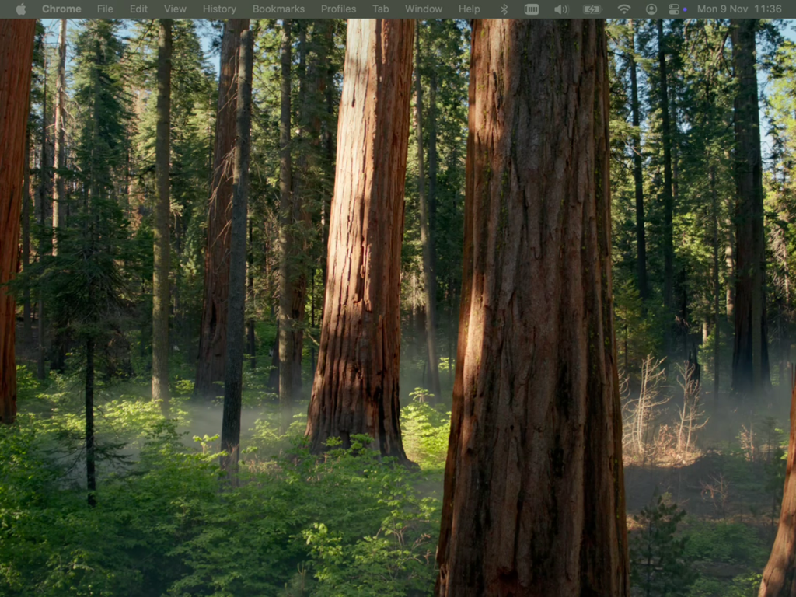

# OpenDisplay receiver for iOS 12

Use a jailbroken **iOS 12** iPad as a wired second display for your Mac.
Tested on an **iPad mini 2 (2013, iOS 12.5.7)** with a MacBook Air M1 on macOS 15.



[OpenDisplay](https://github.com/peetzweg/opendisplay) is a free, open-source alternative to Sidecar.
Its Mac sender works great, but the official iPad app needs iOS/iPadOS 15+, and Sidecar needs iPadOS 13 and newer hardware.
This repo is an independent receiver for older devices: a small Objective-C app that speaks the
[OpenDisplay wire protocol](https://github.com/peetzweg/opendisplay/blob/main/PROTOCOL.md) (pv 3) on iOS 12.

Unofficial and not affiliated with OpenDisplay.

## What you get

- A true extended display, not mirroring: drag windows onto the iPad, arrange it in System Settings → Displays.
- USB only, through `usbmuxd`. No Wi-Fi, no network setup. The app listens on `127.0.0.1:9000`, so nothing on your network can reach it.
- Hardware H.264 decode (VideoToolbox), frames shown as soon as they are decoded.
- The cursor is drawn on the iPad from the control channel, so it moves at input rate.
- Touch: tap = click, hold/drag = drag, two fingers = scroll.
- The Mac reconnects on its own when you open the app (Bonjour presence beacon).

## Latency (measured on iPad mini 2)

Steady motion, time from frame capture on the Mac to the decoded frame on the iPad.
Pick the quality in the OpenDisplay menu on the Mac.

| Quality | Stream | Capture → arrival | A7 decode | Capture → decoded |
|---|---|---|---|---|
| Best | 2048×1536 @ 42 fps | 12–14 ms | 16 ms | 28–30 ms (p95 ~33) |
| **Balanced** | 1536×1152 @ 60 fps | 9–10 ms | 11–12 ms | **21–22 ms** (p95 ~24) |
| Fast | 1024×768 @ 60 fps | 7 ms | 9 ms | 16 ms (p95 ~18–20) |

Add up to one display refresh (≤16 ms) on the iPad. USB round trip: 2–5 ms.
The 2013 A7 decoder needs about 16 ms for a full 2048×1536 frame, so streaming the native resolution at 60 fps does not lower latency. Balanced is the best trade-off on this chip.

## Requirements

- **Mac:** [OpenDisplay](https://github.com/peetzweg/opendisplay/releases) (macOS 14+), with Screen Recording and Accessibility permissions.
- **iPad / iPhone:** arm64 device on iOS 12, jailbroken, with [AppSync Unified](https://github.com/akemin-dayo/AppSync) installed (repo `https://lukezgd.github.io/repo`). Only the iPad mini 2 was tested. Other A7 iPads (iPad Air 1, iPad mini 3) are untested.
- **Build tools:** Xcode Command Line Tools (no full Xcode needed), plus `brew install libimobiledevice ideviceinstaller ldid`.

## Build and install

```bash
scripts/fetch-sdk.sh        # iPhoneOS 14.5 SDK from theos/sdks into ./sdk
./build.sh                  # → build/ODReceiver.ipa
idevicepair pair            # tap "Trust" on the device
ideviceinstaller install build/ODReceiver.ipa
```

Then open **Display** on the device and start OpenDisplay on the Mac. It finds the device over USB and extends the desktop.

## Using it

- **3-finger tap:** stats overlay (fps, latency, decode time) and the decode-limit switch.
- **Decode limit:**
  - **Auto** (default): advertises an H.264 Level 4.2 throughput budget. At Best quality the Mac lowers the frame rate to about 42 fps so the A7 keeps up.
  - **Unlimited:** native resolution at 60 fps.
  - **Safe:** caps the stream at 1600×1200. The app switches here by itself if the decoder keeps failing.
- Launch arguments work too, for example `-decodeMode 1` (0 Auto, 1 Unlimited, 2 Safe).
  With a mounted Developer Disk Image you can launch from the Mac: `idevicedebug --detach run com.rundax.odreceiver -- -decodeMode 1`.
- The Mac sender logs the receiver's stats every 5 s (`PHONE-STATS` lines in `~/Library/Logs/OpenDisplay/opendisplay.log`).

## How it works

```
Mac:  virtual display → ScreenCaptureKit → VideoToolbox H.264 (real-time, no B-frames)
      → usbmuxd → Lightning cable →
iPad: TCP 127.0.0.1:9000 → VTDecompressionSession (hardware) → AVSampleBufferDisplayLayer
```

Everything lives in one file, [`main.m`](main.m): length-prefixed framing, the JSON/video demux, `hello`/`ping`/clock sync, keyframe recovery, cursor sprite and position, touch and scroll input.

## Limitations

- H.264 only (no HEVC on the A7), no Apple Pencil.
- USB only by design.
- On a semi-untethered jailbreak, re-jailbreak after every reboot before opening the app: fakesigned apps don't start otherwise.

## Credits and license

- [OpenDisplay](https://github.com/peetzweg/opendisplay) by Philip Poloczek: the Mac sender, the protocol, and the touch-to-click logic ported here (GPL-3.0).
- [theos/sdks](https://github.com/theos/sdks), [libimobiledevice](https://libimobiledevice.org), [ldid](https://github.com/ProcursusTeam/ldid), [AppSync Unified](https://github.com/akemin-dayo/AppSync).

Written with Claude Code in a single session. Licensed under the [GNU GPL v3](LICENSE).
